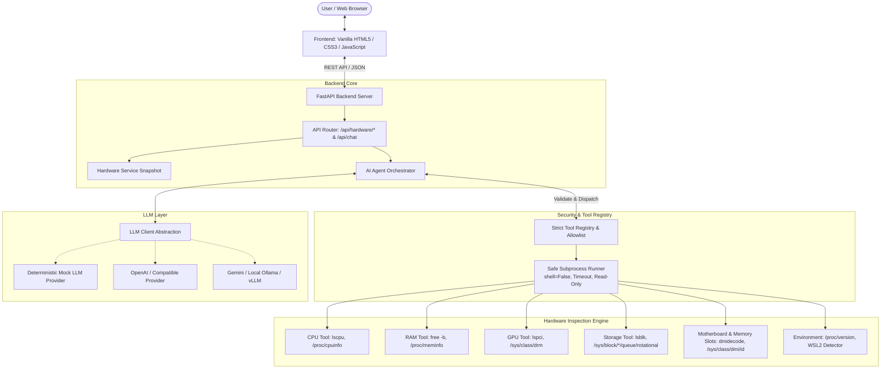

# AI-Powered Hardware Q&A Assistant for Linux

A production-grade, highly secure, and grounded AI-powered Hardware Assistant designed specifically for Linux laptops and desktop systems (with native Ubuntu/Debian support, fallback parsers, and WSL2 hypervisor detection).

Users can query their physical system hardware in plain English (e.g. *"Can I upgrade my RAM to 32 GB?"*, *"Is my SSD NVMe or SATA?"*, *"What GPU do I have?"*). The assistant intelligently invokes strictly allowlisted, predefined Linux system inspection tools (`lscpu`, `free`, `lspci`, `lsblk`, `dmidecode`, sysfs/procfs), validates tool requests, processes telemetry into structured data, and synthesizes answers with zero hallucination.

---

## 1. Project Overview & Problem Statement

### The Problem
Traditional AI chatbots suffer from two fatal flaws when answering hardware queries:
1. **Hallucination**: They guess laptop specifications, invent memory slot configurations, or falsely assume an SSD is high-speed NVMe without verification.
2. **Security Vulnerabilities**: Naive implementations pass LLM-generated shell commands directly into `os.system()` or `subprocess.run(..., shell=True)`, creating severe remote code execution (RCE) and system tampering risks.

### The Solution
The **Linux Hardware AI Assistant** decouples reasoning from execution:
- The LLM identifies what hardware telemetry is needed and issues structured tool calls.
- The Python backend validates requested tools against a rigid security allowlist.
- Predefined Linux commands execute with `shell=False`, argument lists, timeouts, and read-only boundaries.
- The LLM synthesizes natural-language responses strictly grounded in the returned facts. If information is unavailable or requires root permissions (`dmidecode`), the assistant reports this truthfully without guessing.

---

## 2. System Architecture



---

## 3. Technology Stack

- **Frontend**:
  - HTML5 & Responsive Semantic Structure
  - Modern CSS3 (Dark/Neutral Theme, Flexbox, CSS Grid, Custom Scrollbars, Glassmorphism)
  - Vanilla JavaScript (Async Fetch API, Markdown Renderer, Dynamic Telemetry Cards, Modal Viewer)
- **Backend**:
  - Python 3.10+
  - FastAPI & Starlette
  - Uvicorn (ASGI Production Server)
  - Pydantic v2 (Data Validation and Schema Enforcement)
  - Python-Dotenv (Configuration & Secret Management)
- **Hardware Telemetry**:
  - Linux Utilities: `lscpu`, `free`, `lspci`, `lsblk`, `dmidecode`, `uname`
  - Linux Virtual Filesystems: `/proc/cpuinfo`, `/proc/meminfo`, `/proc/version`, `/sys/class/dmi/id/`, `/sys/block/*/queue/rotational`
- **Testing**:
  - Pytest
  - FastAPI `TestClient` / HTTPX
  - Synthetic Linux Command Fixtures

---

## 4. Project Folder Structure

```
hardware-ai-assistant/
│
├── backend/
│   ├── app/
│   │   ├── __init__.py
│   │   ├── main.py                    # FastAPI entrypoint & static frontend mounting
│   │   ├── config.py                  # Pydantic Settings & environment variables
│   │   │
│   │   ├── api/
│   │   │   ├── __init__.py
│   │   │   └── routes.py              # GET /api/health, /api/hardware/*, POST /api/chat
│   │   │
│   │   ├── ai/
│   │   │   ├── __init__.py
│   │   │   ├── agent.py               # AI Agent tool-calling loop & dialogue orchestrator
│   │   │   ├── llm_client.py          # LLM Client interface, OpenAI/Gemini & Mock provider
│   │   │   └── prompts.py             # System prompts & anti-hallucination guidelines
│   │   │
│   │   ├── tools/
│   │   │   ├── __init__.py
│   │   │   ├── base.py                # Safe subprocess runner with strict allowlist & timeouts
│   │   │   ├── registry.py            # Tool allowlist, schema generation, safe dispatcher
│   │   │   ├── cpu.py                 # lscpu & /proc/cpuinfo inspection
│   │   │   ├── ram.py                 # free -b & /proc/meminfo inspection
│   │   │   ├── gpu.py                 # lspci PCI bus graphics inspection
│   │   │   ├── storage.py             # lsblk & NVMe / SATA / HDD media classification
│   │   │   ├── motherboard.py         # dmidecode & /sys/class/dmi/id inspection
│   │   │   └── environment.py         # OS distro & WSL2 hypervisor detector
│   │   │
│   │   ├── services/
│   │   │   ├── __init__.py
│   │   │   └── hardware_service.py    # Subsystem aggregation service
│   │   │
│   │   └── schemas/
│   │       ├── __init__.py
│   │       ├── hardware.py            # Pydantic models for hardware data
│   │       └── chat.py                # Pydantic models for chat requests and responses
│   │
│   ├── tests/
│   │   ├── __init__.py
│   │   ├── conftest.py                # Synthetic Linux CLI fixtures (Intel, AMD, NVMe, SATA, DMI)
│   │   ├── test_cpu.py                # CPU parser unit tests
│   │   ├── test_ram.py                # RAM & meminfo unit tests
│   │   ├── test_gpu.py                # GPU & lspci unit tests
│   │   ├── test_storage.py            # Storage & NVMe/SATA classification tests
│   │   ├── test_motherboard.py        # Motherboard & permission fallback tests
│   │   ├── test_registry_security.py  # Security allowlist & path traversal tests
│   │   ├── test_agent.py              # Multi-tool & conversation context tests
│   │   └── test_api.py                # FastAPI integration tests
│   │
│   ├── verify_e2e.py                  # End-to-end verification script
│   ├── requirements.txt               # Backend dependencies
│   └── .env.example                   # Environment configuration template
│
├── frontend/
│   ├── index.html                     # Responsive single-page dashboard
│   ├── style.css                      # Modern dark neutral design
│   └── script.js                      # Chat UI, live hardware cards, telemetry modal
│
├── README.md                          # Full project documentation
└── .gitignore                         # Git ignore definitions
```

---

## 5. Security Architecture & Guardrails

The application is built around strict zero-trust security boundaries:

1. **No Arbitrary Command Execution**: The backend never passes user strings or LLM-generated text into execution shells.
2. **No `shell=True`**: All commands execute via `subprocess.run(command_args, shell=False, check=False)`.
3. **Strict Binary Allowlist**: Only explicit binaries are permitted: `lscpu`, `free`, `lspci`, `lsblk`, `dmidecode`, `uname`, `cat`. Any attempt to call `rm`, `bash`, `curl`, or unlisted executables throws an immediate security exception.
4. **Strict Tool Registry Allowlist**: Only explicitly registered tool functions (`inspect_cpu`, `inspect_ram`, `inspect_gpu`, `inspect_storage`, `inspect_motherboard`, `inspect_memory_slots`, `inspect_environment`) can be invoked by the LLM.
5. **Enforced Timeouts**: Commands time out after 5 seconds by default to prevent hanging processes or resource starvation.
6. **No Automatic Sudo**: The application never prompts for or escalates to `sudo`. If an unprivileged user executes a command requiring root (such as `dmidecode`), the tool falls back to unprivileged sysfs virtual files (`/sys/class/dmi/id/`) and returns an informative notice.
7. **Virtual Filesystem Path Normalization**: Direct file reads are restricted to safe prefixes (`/proc/cpuinfo`, `/proc/meminfo`, `/proc/version`, `/sys/class/dmi/id/`, `/sys/block/`, `/sys/class/drm/`, `/etc/os-release`). Path traversal attacks (`../`) are blocked.

---

## 6. Installation & Setup

### Prerequisites
- Python 3.10 or higher
- Linux (Ubuntu 20.04/22.04/24.04 recommended) or WSL2 (Windows Subsystem for Linux)
- Standard Linux utilities: `util-linux`, `pciutils`, `dmidecode` (optional for memory slots)

```bash
# On Ubuntu / Debian systems:
sudo apt update
sudo apt install -y util-linux pciutils dmidecode python3 python3-pip python3-venv
```

### Installation Steps

1. **Clone the repository and navigate to backend**:
   ```bash
   cd hardware-ai-assistant/backend
   ```

2. **Create and activate a virtual environment**:
   ```bash
   python3 -m venv venv
   source venv/bin/activate  # On Windows: .\venv\Scripts\activate
   ```

3. **Install dependencies**:
   ```bash
   pip install -r requirements.txt
   ```

4. **Configure Environment Variables**:
   ```bash
   cp .env.example .env
   ```

---

## 7. Configuration & Environment Variables

Edit `backend/.env` to configure your preferred LLM provider:

```ini
# Server Settings
HOST=0.0.0.0
PORT=8000
DEBUG=false
ALLOWED_ORIGINS=*

# AI / LLM Provider Selection
# Options: "mock" (default, offline development), "openai", "gemini"
LLM_PROVIDER=mock

# OpenAI & OpenAI-Compatible (Groq, Ollama, vLLM, DeepSeek)
OPENAI_API_KEY=your_openai_api_key_here
OPENAI_BASE_URL=https://api.openai.com/v1
OPENAI_MODEL=gpt-4o-mini

# Google Gemini (Optional)
GEMINI_API_KEY=your_gemini_api_key_here
GEMINI_MODEL=gemini-2.0-flash

# Security & Command Execution
COMMAND_TIMEOUT_SECONDS=5
ALLOW_DMIDECODE=true
```

> **Note on Mock Mode**: When `LLM_PROVIDER=mock` or no API key is supplied, the built-in deterministic Mock LLM provider is active. It parses user intent, executes the real backend inspection tools, validates tool telemetry, and outputs grounded responses with an explicit `[Mock LLM Mode: Configurable in .env]` header.

---

## 8. Running the Application

### Option A: Run Backend with Integrated Frontend
The FastAPI application automatically serves the frontend at the root URL:

```bash
cd hardware-ai-assistant/backend
python -m uvicorn app.main:app --host 0.0.0.0 --port 8000 --reload
```

Open your browser at:
👉 **`http://localhost:8000`**

### Option B: Run Frontend Separately
If developing the frontend independently, you can serve it via Python's built-in HTTP server or VS Code Live Server:

```bash
cd hardware-ai-assistant/frontend
python -m http.server 3000
```
Open `http://localhost:3000`. The frontend will automatically route API requests to `http://localhost:8000`.

---

## 9. REST API Documentation

FastAPI provides interactive Swagger documentation at **`http://localhost:8000/docs`**.

### Endpoints Overview

| Method | Endpoint | Description |
| :--- | :--- | :--- |
| `GET` | `/api/health` | Backend health status, active LLM provider, and host OS environment |
| `GET` | `/api/hardware` | Complete hardware snapshot (CPU, RAM, GPU, Storage, Motherboard, Environment) |
| `GET` | `/api/hardware/cpu` | CPU model, architecture, cores, threads, clock frequencies, virtualization |
| `GET` | `/api/hardware/ram` | RAM total bytes, used bytes, available bytes, usage percentage |
| `GET` | `/api/hardware/gpu` | Graphics controllers, PCI IDs, vendor, and model |
| `GET` | `/api/hardware/storage` | Block devices, partitions, mountpoints, verified NVMe/SATA/HDD media types |
| `GET` | `/api/hardware/motherboard`| Motherboard manufacturer, model, BIOS version and date |
| `GET` | `/api/hardware/memory-slots`| Motherboard DMI memory slots, occupied slots, max supported capacity |
| `GET` | `/api/hardware/environment` | Host OS distribution, kernel version, and WSL2 detection |
| `POST`| `/api/chat` | Natural-language query endpoint with conversation history and tool-calling |

### Sample `POST /api/chat` Request & Response

**Request**:
```json
{
  "message": "Can I upgrade my RAM to 32 GB?",
  "history": []
}
```

**Response**:
```json
{
  "answer": "**[Mock LLM Mode: Configurable in .env]**\n\n**System Memory (RAM)**:\n- **Total**: 16.00 GB\n- **Available**: 9.55 GB\n- **In Use**: 6.45 GB (40.3%)\n\n**Memory Slots & Upgrade Status**:\n- **Total Slots**: 2\n- **Occupied Slots**: 1\n- **Maximum Supported Capacity**: 32 GB\n- **Upgrade Assessment**: You have 1 free memory slot(s) available for expansion.",
  "tools_used": [
    "inspect_ram",
    "inspect_memory_slots"
  ],
  "tool_results": [
    {
      "tool_name": "inspect_ram",
      "display_name": "RAM Inspector",
      "success": true,
      "data": { ... }
    },
    {
      "tool_name": "inspect_memory_slots",
      "display_name": "Memory Slots & Upgrade Inspector",
      "success": true,
      "data": { ... }
    }
  ],
  "is_mock": true
}
```

---

## 10. Example Questions & Multi-Turn Follow-Ups

| Question | Tools Executed | Expected Grounded Behavior |
| :--- | :--- | :--- |
| *"How much RAM do I have?"* | `inspect_ram` | Reports exact total, used, and available memory from `free -b` or `/proc/meminfo`. |
| *"Which processor does my laptop use?"* | `inspect_cpu` | Inspects `lscpu`, extracts model name, architecture, core count, thread count, and virtualization. |
| *"What GPU do I have?"* | `inspect_gpu` | Scans PCI bus via `lspci` for VGA, 3D, and Display controllers. |
| *"Is my SSD NVMe or SATA?"* | `inspect_storage` | Analyzes `lsblk` transport (`tran`) and `/sys/block/*/queue/rotational`. Explicitly identifies NVMe vs SATA without guessing. |
| *"Can I upgrade my RAM to 32 GB?"* | `inspect_ram`, `inspect_memory_slots` | Queries both memory utilization and physical DMI slots. Confirms free slots and max supported capacity. |
| *Follow-up: "Is it good for machine learning?"* | *Context reasoning* | Utilizes previously detected GPU/RAM in dialogue history. Clearly distinguishes hardware facts from recommendations. |

---

## 11. Testing & Validation

The test suite contains 41 automated tests covering:
- JSON and plain text output parsing for `lscpu` and `/proc/cpuinfo`
- `free -b` and `/proc/meminfo` memory calculations
- Dual GPU (Intel Iris + NVIDIA RTX) and AMD graphics detection
- Storage media classification (NVMe SSD, SATA SSD, mechanical HDD)
- Handling of missing Linux utilities (exit code 127)
- Unprivileged permission handling for `dmidecode` (exit code 126 / fallback to sysfs)
- Security allowlist enforcement (rejection of unauthorized binaries and tool names)
- Path traversal prevention
- AI Agent multi-tool calling workflows and conversational context retention
- Full FastAPI endpoint integration tests

### Running Tests

```bash
cd hardware-ai-assistant/backend
python -m pytest tests -v
```

### Running End-to-End Verification

```bash
python verify_e2e.py
```

---

## 12. Limitations & Future Improvements

- **WSL2 Virtualization**: Under WSL2, the Windows hypervisor virtualizes motherboard DMI tables and PCIe topology. The application detects this state and displays an alert.
- **Root Permissions for Memory Slots**: `dmidecode` requires root privileges on Linux. Without elevated rights, slot topology cannot be queried from user space.
- **Future Improvements**:
  - Add optional thermal sensor inspection via `lm-sensors` (`sensors` binary).
  - Add battery health and cycle count inspection via `/sys/class/power_supply/BAT*`.
  - Add streaming token responses (`text/event-stream` / Server-Sent Events) for real-time LLM typing.
